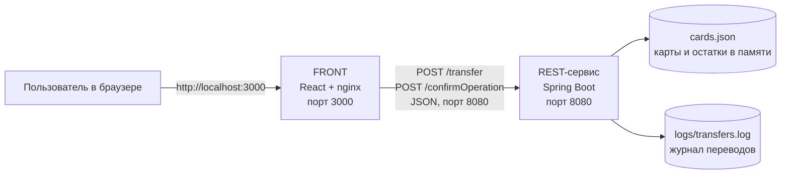

# Сервис перевода денег

REST-сервис для перевода денег с одной банковской карты на другую. Реализует протокол из
[MoneyTransferServiceSpecification.yaml](https://github.com/netology-code/jd-homeworks/blob/master/diploma/MoneyTransferServiceSpecification.yaml)
и работает с готовым FRONT [serp-ya/card-transfer](https://github.com/serp-ya/card-transfer) без доработок (копия FRONT лежит в папке `front/`).

Стек: Java 17, Spring Boot 3.3.4, Maven, Docker, Docker Compose, JUnit 5, Mockito, Testcontainers.

## Быстрый старт

Нужны только Docker и Docker Compose.

```
docker compose up --build
```

Первая сборка занимает несколько минут (скачиваются Maven-зависимости и npm-пакеты).

| Описание              | Адрес                                                              |
|-----------------------|--------------------------------------------------------------------|
| FRONT (веб-интерфейс) | http://localhost:3000                                              |
| REST-сервис           | http://localhost:8080 (`POST /transfer`, `POST /confirmOperation`) |

Остановка: `Ctrl+C`, затем `docker compose down`.

### Как проверить через FRONT

Откройте http://localhost:3000 и введите:

| Поле              | Значение                                            |
|-------------------|-----------------------------------------------------|
| Карта отправителя | `1111 1111 1111 1111`                               |
| Срок действия     | `12/30`                                             |
| CVC               | `111`                                               |
| Карта получателя  | `2222 2222 2222 2222` (или любая другая из 16 цифр) |
| Сумма             | например `100`                                      |

FRONT сам вызывает `/transfer`, затем `/confirmOperation` с кодом `0000` и показывает окно «успех» или текст ошибки.

## Тестовые карты

Данные карт хранятся в файле [`src/main/resources/cards.json`](src/main/resources/cards.json):

| Номер            | Срок  | CVV | Остаток        |
|------------------|-------|-----|----------------|
| 1111111111111111 | 12/30 | 111 | 100 000.00 RUR |
| 2222222222222222 | 11/30 | 222 | 50 000.00 RUR  |
| 3333333333333333 | 10/30 | 333 | 1 000.00 RUR   |

## Схема приложений



Браузер открывает FRONT и сам отправляет запросы на REST-сервис. Поэтому в сервисе включён CORS (разрешены запросы с другого порта).

## Архитектура сервиса

```
ru.netology.moneytransfer
├── controller   TransferController          принимает запросы /transfer и /confirmOperation
├── service      TransferService             вся бизнес-логика: проверки, комиссия, списание и зачисление
├── repository   CardRepository              доступ к картам
│                InMemoryCardRepository      читает cards.json при старте, держит карты в памяти
├── journal      TransferJournal             журнал переводов
│                FileTransferJournal         пишет строки в logs/transfers.log
├── model        Card, Operation, DTO        данные: карта, операция, запросы и ответы
├── exception    InvalidInputException       → ответ 400
│                TransferException           → ответ 500
│                GlobalExceptionHandler      превращает исключения в {"message", "id"}
└── config       WebConfig                   CORS и часы (Clock)
```

### Как проходит перевод (два шага)

1. **`POST /transfer`**. Сервис проверяет данные: номера карт (16 цифр), CVV (3 цифры), срок `ММ/ГГ`, сумма больше нуля, валюта `RUR`. Затем находит карту отправителя, сверяет срок и CVV и проверяет, что хватает денег на сумму и комиссию. Если всё в порядке, создаётся операция со статусом «ожидает подтверждения» и возвращается её `operationId`. Деньги пока не списаны.
2. **`POST /confirmOperation`**. Сервис проверяет, что операция существует и ещё не обработана, и сверяет код. Затем списывает с карты отправителя сумму и комиссию и зачисляет сумму на карту получателя (если она есть в сервисе). Возвращается тот же `operationId`.

### Правила и допущения

- Комиссия: **1 %** от суммы, считается в копейках (округление вниз). Списывается с отправителя сверх суммы, получателю зачисляется сумма без комиссии.
- `amount.value` — в **копейках** (FRONT отправляет рубли × 100). Валюта — `RUR`, как у FRONT.
- Код подтверждения — `0000` (FRONT всегда отправляет его). Меняется в `application.properties`.
- Карта отправителя должна быть в `cards.json`. Карта получателя может быть любой: если её нет в хранилище, деньги просто списываются с отправителя.
- Остатки меняются в памяти: после перезапуска сервиса они возвращаются к значениям из `cards.json`.
- Ошибки: **400** — неверные данные (текст в `message`), **500** — ошибка перевода или внутренняя ошибка. В поле `id` — порядковый номер ошибки.

### Настройки

Все настройки в [`application.properties`](src/main/resources/application.properties):

| Свойство                        | Значение по умолчанию  | Назначение                                                |
|---------------------------------|------------------------|-----------------------------------------------------------|
| `server.port`                   | 8080                   | порт сервиса                                              |
| `transfer.cards-file`           | `classpath:cards.json` | файл с картами (можно внешний: `file:/config/cards.json`) |
| `transfer.journal-file`         | `logs/transfers.log`   | журнал переводов                                          |
| `transfer.commission-percent`   | 1                      | комиссия, %                                               |
| `transfer.confirmation-code`    | 0000                   | код подтверждения                                         |
| `transfer.cors-allowed-origins` | `*`                    | откуда разрешены запросы из браузера                      |

Любое свойство можно переопределить переменной окружения (например, `TRANSFER_COMMISSION_PERCENT=2`).

### Формат хранения карт

Файл `cards.json` — массив объектов:

```json
[
  { "number": "1111111111111111", "validTill": "12/30", "cvv": "111", "currency": "RUR", "balance": 10000000 }
]
```

- `number` — 16 цифр без пробелов;
- `validTill` — `ММ/ГГ`; карта действует до конца указанного месяца;
- `cvv` — 3 цифры;
- `currency` — код валюты;
- `balance` — остаток **в копейках** (`10000000` = 100 000.00 руб.).

### Журнал переводов

Каждое событие пишется одной строкой в `logs/transfers.log` (папка `logs` при запуске через Docker Compose появляется рядом с проектом):

```
2026-11-06 | 21:20:43 | операция: 8e4c9640-... | с карты: 1111********1111 | на карту: 2222********2222 | сумма: 100.00 RUR | комиссия: 1.00 RUR | результат: Операция создана, ожидает подтверждения
2026-11-06 | 21:20:43 | операция: 8e4c9640-... | с карты: 1111********1111 | на карту: 2222********2222 | сумма: 100.00 RUR | комиссия: 1.00 RUR | результат: Успешно
2026-11-06 | 21:20:43 | операция: fea6f988-... | с карты: 9999********9999 | на карту: 2222********2222 | сумма: 1.00 RUR | комиссия: 0.01 RUR | результат: Отклонено: Карта отправителя не найдена
```

В строке: дата, время, операция, карта списания, карта зачисления, сумма, комиссия, результат. Номера карт маскируются (видны первые и последние 4 цифры), CVV в журнал не попадает.

## Примеры запросов (curl)

Файлы с телами запросов лежат в папке [`examples/`](examples).

**Linux, macOS, Git Bash:**

```bash
# 1. Создать перевод
curl -X POST http://localhost:8080/transfer \
  -H "Content-Type: application/json" \
  -d '{"cardFromNumber":"1111111111111111","cardFromValidTill":"12/30","cardFromCVV":"111","cardToNumber":"2222222222222222","amount":{"value":10000,"currency":"RUR"}}'
# Ответ: {"operationId":"8e4c9640-9c67-4580-a3f7-d758e709c49e"}

# 2. Подтвердить операцию (подставьте operationId из ответа)
curl -X POST http://localhost:8080/confirmOperation \
  -H "Content-Type: application/json" \
  -d '{"operationId":"8e4c9640-9c67-4580-a3f7-d758e709c49e","code":"0000"}'
# Ответ: {"operationId":"8e4c9640-9c67-4580-a3f7-d758e709c49e"}
```

```powershell
curl.exe -X POST http://localhost:8080/transfer -H "Content-Type: application/json" -d "@examples/transfer.json"
curl.exe -X POST http://localhost:8080/confirmOperation -H "Content-Type: application/json" -d "@examples/confirm.json"
```

**Примеры ошибок:**

```bash
# Неверный CVV -> 400
curl -X POST http://localhost:8080/transfer -H "Content-Type: application/json" \
  -d '{"cardFromNumber":"1111111111111111","cardFromValidTill":"12/30","cardFromCVV":"999","cardToNumber":"2222222222222222","amount":{"value":100,"currency":"RUR"}}'
# {"message":"Неверные данные карты отправителя","id":1}

# Неверный код подтверждения -> 400
curl -X POST http://localhost:8080/confirmOperation -H "Content-Type: application/json" \
  -d '{"operationId":"8e4c9640-9c67-4580-a3f7-d758e709c49e","code":"1234"}'
# {"message":"Неверный код подтверждения","id":2}
```

## Тесты

- **Юнит-тесты** (JUnit 5 + Mockito): `TransferServiceTest`, `TransferControllerTest`, `InMemoryCardRepositoryTest`, `FileTransferJournalTest`.
  ```
  mvn test
  ```
- **Интеграционный тест** (Testcontainers): `MoneyTransferIT` запускает готовый Docker-образ сервиса и вызывает его по HTTP. Сначала соберите образ, затем запустите проверку (нужен запущенный Docker):
  ```
  docker build -t money-transfer-service .
  mvn verify
  ```


## Структура репозитория

```
├── src/main              код сервиса, application.properties, cards.json
├── src/test              юнит-тесты и интеграционный тест
├── front/                FRONT (serp-ya/card-transfer) + Dockerfile для его сборки
├── examples/             тела запросов для curl
├── logs/                 сюда пишется журнал переводов
├── Dockerfile            образ REST-сервиса
├── docker-compose.yml    запуск сервиса и FRONT
└── pom.xml
```
